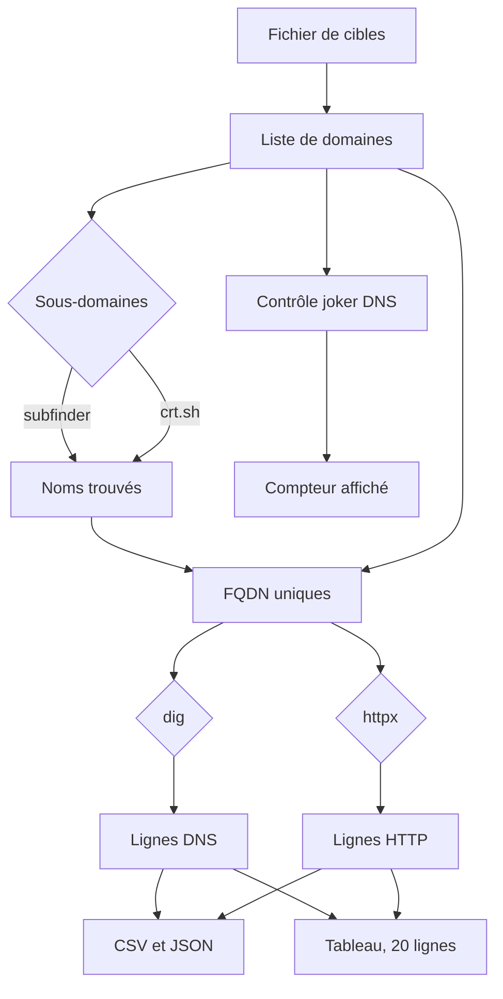

# Fonctionnement

`fqdnscan` enchaîne cinq étapes. Chaque étape peut être décochée dans le menu, sauf la lecture du fichier et l'export.



## 1. Fichier

Une cible par ligne. `example.com` et `www.example.com` sont acceptés tels quels. Les doublons disparaissent, la casse est mise en minuscules.

Le chemin vient du premier argument, ou d'un sélecteur si on lance le script sans argument.

## 2. Sous-domaines

Deux sources, indépendantes :

| Source | Moyen | Ce qui est gardé |
| --- | --- | --- |
| subfinder | binaire local, 60 s max par domaine | noms qui appartiennent au domaine |
| crt.sh | `https://crt.sh/?q=%.domaine&output=json` | noms de certificats, sans les `*` |

Un nom déjà présent garde sa première source. Les cibles du fichier ont la source `fichier`.

Un nom n'est rattaché au domaine que s'il est égal à ce domaine, ou s'il s'en termine par `.domaine`. Ça écarte `pasexemple.com` quand on cherche `exemple.com`.

Si `subfinder` n'est pas installé, ou si crt.sh ne répond pas, cette source ne renvoie rien. Le reste continue.

## 3. Joker DNS

Pour chaque domaine du fichier, le script demande l'enregistrement A d'un nom tiré au hasard (`dig +short`). Une réponse non vide signifie qu'un joker répond à n'importe quel sous-domaine.

Ce contrôle ne retire aucun nom. Il sert à lire le compteur dans la barre de progression avant d'interpréter les adresses.

## 4. Résolution

Pour chaque FQDN et chaque type coché (`A`, `AAAA`, `CNAME`, `MX`, `NS`, `SOA`, `TXT`), un appel :

```text
dig +noall +answer +comments +time=3 +tries=1 <fqdn> <type>
```

Le statut (`NOERROR`, `NXDOMAIN`, …) vient de l'en-tête. Chaque ligne de la section ANSWER devient un enregistrement : nom, TTL, classe, type, valeur. S'il n'y a pas de réponse, une ligne est quand même écrite, avec le type demandé et le statut, sans valeur.

`dig` absent ou en timeout produit le statut `ERROR`.

## 5. HTTP

Si la case httpx est cochée, les FQDN sont écrits dans un fichier temporaire, puis :

```text
httpx -l <fichier> -silent -json -title -tech-detect -status-code
```

Délai global : 120 secondes. Chaque ligne JSON devient un enregistrement de source `httpx` (URL, code, titre, serveur ou technologies). Le fichier temporaire est effacé ensuite. Sans binaire `httpx`, cette étape ne produit aucune ligne.

## Sortie

Les lignes sont triées par FQDN. Pour un même nom, les lignes DNS passent avant la ligne HTTP.

Le terminal affiche 20 lignes. `results/recon_AAAAMMJJ_HHMMSS.csv` et le JSON du même nom contiennent tout. Le dossier `results/` n'est pas versionné.
